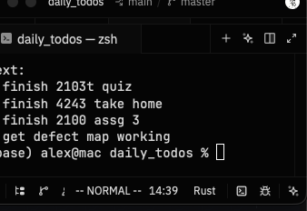

# Daily Todo

A tiny task list for focusing on one thing at a time.

## Edit your tasks

Open [`src/main.rs`](src/main.rs) and change the strings in `NOW` and `NEXT`:

```rust
const NOW: &str = "the task I'm working on";
const NEXT: [&str; 2] = ["the next task", "another task"];
```

Keep the number in `[&str; 2]` equal to the number of items in `NEXT`. Only the first NEXT item is displayed.

## Commands

Run these from the project folder:

| Command | What it does |
| --- | --- |
| `cargo run --quiet` | Show NOW and the first NEXT task. |
| `cargo run --quiet -- --done` | Add NOW to `done.txt` and move the first NEXT task into NOW. |
| `cargo run --quiet -- --undo` | Undo the latest completion. |
| `cargo run --quiet -- --skip` | Swap NOW with the first NEXT task. |

`--skip` does not add anything to `done.txt`.

## Demo

The small Zed terminal setup (screenshot from an earlier version of the display):


